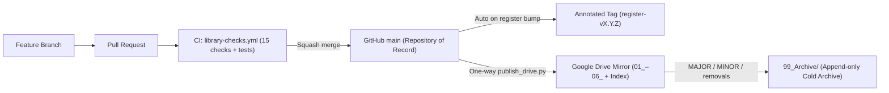

<p>
  <picture>
    <source media="(prefers-color-scheme: dark)" srcset="Standards%20Design/02_Assets/AST-B01-04_Parent-Lockup-White.svg" />
    <source media="(prefers-color-scheme: light)" srcset="Standards%20Design/02_Assets/AST-B01-03_Parent-Lockup.svg" />
    
  </picture>
</p>

# Standards Design

The authoritative standards library and design system of **Irvantri Standards** (`Irvantri Standards Pte. Ltd.`). Turns organizational requirements into controlled normative standards, single-source design tokens, executable authoring templates, and verifiable governance records.

[](https://github.com/haryirfantri/irvantri-standards/actions/workflows/library-checks.yml)

[Start here](#start-here) · [Library inventory](#library-inventory) · [Standards architecture](#standards-architecture) · [Workflow & governance](#workflow--governance) · [Tooling & verification](#tooling--verification) · [Authority & precedence](#authority--precedence)

---

<!-- BEGIN:README-STATUS -->
> **Status:** Approved · **Register:** `v2.0.1` · **Last updated:** 2026-11-28
<!-- END:README-STATUS -->

## Start here

Select the entry point that matches the task:

| Task | Primary entry points |
| :--- | :--- |
| **Browse the full controlled catalog** | [Library Index (`Library-Index.md`)](Standards%20Design/Library-Index.md) — active versions, statuses, owners, review dates, and artifact pins |
| **Author a formal A4 document** | [Formal Document Master (`TPL-E01-06`)](Standards%20Design/03_Templates/TPL-E01-06_Formal-Document-Master.html) · [Quick-Start Guide (`PUB-04`)](Standards%20Design/04_Publications/PUB-04_Document-Master-Quick-Start.md) · [Cover Template (`TPL-E01-03`)](Standards%20Design/03_Templates/TPL-E01-03_Formal-Cover-Digital.html) |
| **Build a web interface or product** | [Brand & Design System Guide (`PUB-01`)](Standards%20Design/04_Publications/PUB-01_Brand-and-Design-System-Guide.html) · [Tokens `JSON`](Standards%20Design/02_Assets/AST-D01-01_Design-Tokens.json) & [`CSS`](Standards%20Design/02_Assets/AST-D01-02_Design-Tokens.css) · [Component Kit](Standards%20Design/02_Assets/AST-D03-01_Component-Kit.css) & [Gallery](Standards%20Design/02_Assets/AST-D03-02_Component-Gallery.html) |
| **Configure an AI coding assistant** | [AI Design System Context (`PUB-03` / `DESIGN.md`)](Standards%20Design/04_Publications/PUB-03_AI-Design-System-Context.md) |
| **Read the institutional overview** | [Company Overview (`PUB-02`)](Standards%20Design/04_Publications/PUB-02_Company-Overview.md) |
| **Contribute or release a change** | [Agent & Contributor Playbook (`AGENTS.md`)](AGENTS.md) · [Tooling Reference (`tools/README.md`)](tools/README.md) |

---

## Library inventory

Counts and register metadata below are synchronized directly from [Library-Index.md](Standards%20Design/Library-Index.md) via `tools/build_readme.py` and verified on every pull request.

<!-- BEGIN:README-COUNTS -->
| Resource | Count | Purpose |
| --- | ---: | --- |
| Normative standards | 23 | Binding rules across active Series A–E (`A01`–`E05`) |
| Master assets | 27 | Canonical marks, favicons/app icons, design tokens (`JSON` + `CSS`), component kit, and gallery |
| Executable templates | 4 active | Single-file `HTML` authoring masters (`TPL-E01-03`, `TPL-E01-06`) and official letterheads (`TPL-E04-01`/`03`); `TPL-E04-02` `Planned` |
| Compiled publications | 4 | Human-facing and AI-facing reference documents (`PUB-01`–`PUB-04`) |
| Governance records | 17 | Reviews, audits, and measured Pre-Release Gates (`REC-A04-001`–`017`) |
<!-- END:README-COUNTS -->

---

## Standards architecture

Normative rules are organized into coded series (`A02`). Series **A–E** are active and binding; Series **F–H** are reserved for future activation.

| Series | Domain | Scope | Active codes |
| :---: | :--- | :--- | :---: |
| [**A**](Standards%20Design/01_Standards/A_Governance/) | **Governance & Traceability** | Document control, taxonomy & naming, entity architecture, compliance & exceptions | `A01`–`A04` |
| [**B**](Standards%20Design/01_Standards/B_Visual-Foundations/) | **Visual Foundations** | Marks & lockups, color system, typography, grids & graphic devices, iconography | `B01`–`B05` |
| [**C**](Standards%20Design/01_Standards/C_Information-and-Verbal/) | **Information & Verbal** | Voice & plain language, terminology, technical & UX writing, data, dates & citations | `C01`–`C04` |
| [**D**](Standards%20Design/01_Standards/D_Digital-Systems/) | **Digital Systems** | Design tokens, responsive shells, interface components, accessibility, generated exports | `D01`–`D05` |
| [**E**](Standards%20Design/01_Standards/E_Documents-and-Print/) | **Documents & Print** | Formal layout, versioning & draft marking, print specs, correspondence, body elements | `E01`–`E05` |
| **F–H** | **Reserved** | Future activation: systems & engineering, delivery, quality & security | *Reserved* |

---

## Workflow & governance

Per [A01 §5.9](Standards%20Design/01_Standards/A_Governance/A01_Document-Control.md), **Standards Design** separates controlled authoring from stakeholder distribution:



- **GitHub (`main`) — Authoring Repository of Record (`A01 §5.9.1`–`§5.9.2`):** All revisions are authored on feature branches, validated by `library-checks.yml`, and squash-merged to protected `main`. Annotated release tags (`register-vX.Y.Z`) are created automatically by [tag-release.yml](.github/workflows/tag-release.yml).
- **Google Drive (`Standards Design/`) — Distribution Mirror & Cold Archive (`A01 §5.9.3`):** Published strictly one-way from `main` via `tools/publish_drive.py`. Active files update in place to preserve file IDs and shared links; outgoing `MAJOR`/`MINOR` snapshots and retired files are preserved immutably in `99_Archive/`.
- **Measured Pre-Release Gates (`A04 §5.1.5`–`§5.1.7`):** Controlled releases record objective, reproducible measurements and cite the verifying CI run in `05_Records/REC-A04-0xx`.

---

## Repository structure

```text
Standards Design/               Controlled library root (mirrored one-way to Google Drive)
├── Library-Index.md            Authoritative master register
├── 01_Standards/               Normative standards (Series A–E)
├── 02_Assets/                  Brand marks (SVG/PNG/ICO), tokens (JSON/CSS), component kit & gallery
├── 03_Templates/               Executable HTML authoring masters and print/digital letterheads
├── 04_Publications/            Compiled handbooks, AI context (DESIGN.md), and quick-start guide
├── 05_Records/                 Immutable reviews, audits, and Pre-Release Gate records (REC-A04-*)
└── 06_Dependencies/            Tracked third-party fonts, scripts, ICC profile & SHA-256 manifest

tools/                          Automated checks, release helpers, builders, PDF tools, and tests
.github/                        CI workflows (library-checks, tag-release), PR template, CODEOWNERS
AGENTS.md                       Contributor and AI agent playbook & release checklist
```

---

## Tooling & verification

Generated artifacts (`AST-D01-02_Design-Tokens.css`, `TPL-E01-06_Formal-Document-Master.html`, and the status/count blocks in `README.md`) are built from source and verified for zero drift in CI. Never edit generated outputs by hand.

| Command | Purpose |
| :--- | :--- |
| `pip install -r tools/requirements.txt` | Install the single external dependency (`pypdf`) for PDF preflight and press export |
| `python3 tools/library_checks.py --report-dir check-report` | Run all 15 automated governance, palette, token, contrast, link, PDF, HTML, and dependency checks |
| `python3 -m unittest discover -s tools/tests -v` | Run unit tests for release automation, governance checks, and the Drive publisher |
| `python3 tools/bump.py <CODE\|INDEX> <major\|minor\|errata> --note "..."` | Bump versions across headers, Revision History, `Library-Index.md`, `Sync Required` pins, and `README.md` |
| `python3 tools/build_tokens_css.py [--check]` | Generate or drift-check `AST-D01-02_Design-Tokens.css` from `AST-D01-01_Design-Tokens.json` |
| `python3 tools/build_document_master.py [--check]` | Generate or drift-check `TPL-E01-06_Formal-Document-Master.html` from `tools/document-master/` |
| `python3 tools/build_readme.py [--check]` | Synchronize or drift-check `README.md` status and count blocks from `Library-Index.md` |
| `python3 tools/publish_drive.py --dry-run \| --apply` | Preview or execute one-way publish from `main` to the Google Drive Distribution Mirror |
| `python3 tools/press_export.py <file.pdf>` / `tools/pdf_finish.py <file.pdf>` | Convert HTML master press exports to `PDF/X-4` (`FOGRA39`) or finalize digital A4 PDF bookmarks/metadata |

See [tools/README.md](tools/README.md) for detailed check coverage and [Dependencies-Manifest.md](Standards%20Design/06_Dependencies/Dependencies-Manifest.md) for third-party checksums and licenses.

---

## Authority & precedence

Where two controlled items conflict, precedence resolves strictly from top to bottom (`A01 §5.1.4`):

1. Statutory, regulatory, and contractual obligations
2. Series A governance and traceability (`A01`–`A04`)
3. Active normative standards (`B01`–`E05`)
4. Master assets (`AST-`) and executable templates (`TPL-`)
5. Compiled publications (`PUB-`)
6. Project and product specifications

Compiled publications are informative and do not override underlying normative standards. Where the Google Drive Distribution Mirror differs from GitHub `main`, GitHub `main` prevails (`A01 §5.9.3`).

---

**Irvantri Standards** (`Irvantri Standards Pte. Ltd.`) — *A member of Irvantri Group*  
Maintained by the Irvantri Standards Owner and Approver. Canonical changes are recorded in [Library-Index.md](Standards%20Design/Library-Index.md) and Git history.